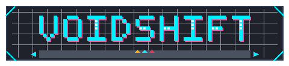

# VOIDSHIFT

> **Top-Down Sci-Fi Gravitational Roguelite for Android**  
> Engine: Godot 4.3 (GDScript) | Platform: Android Landscape (Offline)



---

## 🚀 Overview

**VOIDSHIFT** is an original sci-fi roguelite set aboard the abandoned orbital station *Aegis-IV*. An autonomous security purge wiped out the human crew, leaving behind patrolling sentry automata, breached bulkheads, magnetic conduit tracks, and experimental gravitational systems.

Equipped with an **Omni-Gravitational RIG Suit**, the player can dynamically shift the station's local gravity by **90 degrees** in real time (Down, Right, Up, Left). Gravity shifts alter traversal, disorient hostile machines, and propel heavy cargo crates across rooms to crush enemies.

---

## 🕹️ Controls

### Desktop / Keyboard & Mouse
| Action | Primary Key | Secondary Key |
| :--- | :--- | :--- |
| **Move** | `W` / `A` / `S` / `D` | Arrow Keys |
| **Grav-Shift Clockwise (↷ 90°)** | `E` | Keypad 6 |
| **Grav-Shift Counter-Clockwise (↶ 90°)** | `Q` | Keypad 4 |
| **Grav-Shift Invert (180°)** | `R` | Keypad 8 |
| **Primary Fire (Plasma)** | `Space` | Left Mouse Click |
| **Kinetic Dash** | `Shift` | Right Mouse Click |
| **Interact / Airlock** | `F` | Enter |
| **Pause / Systems Menu** | `Escape` | `P` |

### Android / Touch Controls
- **Virtual Analog Joystick**: Bottom-left thumb zone with dynamic deflection tracking and deadzone handling.
- **Clockwise (↷) & Counter-Clockwise (↶) Shift Buttons**: Dedicated ergonomic thumb buttons.
- **Combat & Dash Buttons**: Dedicated firing and dash triggers at bottom-right thumb zone.
- **Tactical Pause Button**: Top-right corner.

---

## 📦 Project Architecture

```
VoidShift/
├── project.godot               # Godot 4.3 engine configuration
├── export_presets.cfg          # Android ARM64 export preset
├── .gitignore
├── assets/
│   ├── audio/
│   │   ├── ambient/            # Loopable station drone (ambient_station_drone.wav)
│   │   └── sfx/                # Procedural 16-bit WAV SFX (shift, shoot, hit, chime, etc.)
│   └── sprites/
│       ├── enemies/            # Sentry drone (32x32)
│       ├── logo/               # VOIDSHIFT pixel art brand logo (480x110)
│       ├── player/             # Omni-Grav RIG suit (32x32)
│       ├── props/              # Crates, scrap metal, energy cells
│       ├── tiles/              # Bulkheads, hazard panels, floor, airlock
│       └── ui/                 # Joysticks, shift arrows, buttons, compass
├── docs/
│   ├── ARCHITECTURE.md         # Full technical system architecture
│   └── HANDOFF.md              # Phase 2 implementation roadmap for Codex
├── scenes/
│   ├── combat/                 # Plasma projectiles (player & enemy)
│   ├── enemies/                # Sentry drone enemy
│   ├── player/                 # Player RIG & dynamic camera
│   ├── props/                  # Physics crates & pickups
│   ├── tests/                  # Headless integration test scene
│   ├── ui/                     # Virtual joystick, HUD, touch overlay, menus
│   └── world/                  # Playable test sector & rooms
├── scripts/
│   ├── combat/                 # HealthComponent, HitboxComponent, HurtboxComponent
│   ├── core/                   # Autoloads: EventBus, GravityManager, AudioManager, SaveManager, LootManager, GameManager, Constants
│   ├── enemies/                # EnemyBase & SentryDrone AI
│   ├── player/                 # Player controller & PlayerCamera
│   ├── props/                  # GravCrate & PickupBase
│   ├── tests/                  # Automated verification suite (89/89 passing across 17 groups)
│   ├── ui/                     # HUD, touch controls, menus
│   └── world/                  # RoomBase, RoomTemplate, DungeonBuilder, TestSector
└── tools/
    ├── generate_assets.py      # Pillow-based pixel art asset generator
    └── generate_audio.py       # Procedural 16-bit WAV audio generator
```

---

## 🧪 Automated Verification & Testing

The project includes an in-engine headless test suite that tests all autoload singletons, physics, gravity shifts, combat components, saving/loading, and scene instantiations:

```bash
# Run headless automated test suite
godot --headless --path VoidShift scenes/tests/test_runner_scene.tscn

# Run test sector simulation directly
godot --headless --path VoidShift scenes/world/test_sector.tscn --quit-after 60
```

**Results:** 89 / 89 Tests Passing (0 Failures) — including a full-run smoke test that
procedurally builds a sector, walks every room through real airlock transitions, clears
all threats, defeats the boss, and verifies the VICTORY state persists to disk.

### Headless CI notes
- Run `godot --headless --editor --quit --path VoidShift` once (or `--import` in 4.3+)
  before the test suite on a fresh checkout: it regenerates `.godot/global_script_class_cache.cfg`
  (it is git-ignored); otherwise scripts referencing newer `class_name` types fail to parse.
- Godot 4.3's headless audio driver intentionally leaks `AudioStreamPlaybackWAV` objects at
  exit ("ObjectDB instances leaked") — an upstream engine limitation, not a project leak.


---

## 📱 Mobile Specifications (Android)

- **Target SDK**: 34 | **Min SDK**: 24 (Android 7.0+)
- **Orientation**: Sensor Landscape (`window/handheld/orientation=4`)
- **Rendering Method**: `gl_compatibility` (OpenGL ES 3.0 fallback ensures zero driver crashes across Mali, Adreno, PowerVR, and software rasterizers)
- **Pixel Art Filter**: Nearest (`textures/canvas_textures/default_texture_filter=0`)
- **Offline**: Zero external network dependencies, no telemetry, no paid APIs.
- **Storage**: Clean local JSON persistence via `user://savegame.json` and `user://settings.json`.
