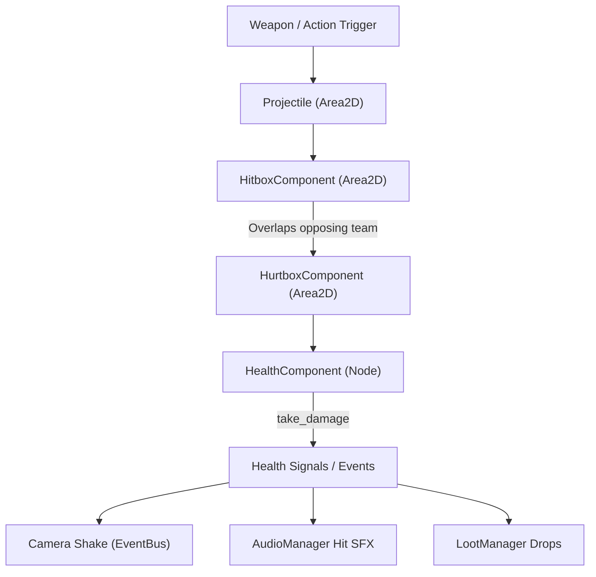

# VOIDSHIFT Technical Architecture Specification

## 1. Design Philosophy
- **Modular Component-Based Architecture**: Systems communicate through decoupling abstractions (`EventBus` signals and modular components like `HealthComponent`, `HitboxComponent`, `HurtboxComponent`).
- **Low Memory & Low Power Profile**: Designed strictly for mid-range Android devices. Zero GC churn during runtime loops, pooled audio channels, and integer math coordinates where feasible.
- **Offline First**: All progression, settings, and gameplay loops are stored locally in `user://` with fault-tolerant JSON serialization.

---

## 2. Core Subsystems & Autoloads

### 2.1 `Constants.gd` (`Constants`)
- Defines global enums: `GravityDirection` (DOWN=0, RIGHT=1, UP=2, LEFT=3), `GameState`, `CombatTeam`.
- Defines cardinal vectors:
  - `DOWN`: `Vector2(0, 1)` (0°)
  - `RIGHT`: `Vector2(1, 0)` (90°)
  - `UP`: `Vector2(0, -1)` (180°)
  - `LEFT`: `Vector2(-1, 0)` (270°)
- Physics collision layers:
  - Layer 1: `LAYER_WORLD` (Bulkheads, walls, solid props)
  - Layer 2: `LAYER_PLAYER` (Player physics & hurtbox)
  - Layer 3: `LAYER_ENEMY` (Enemy physics & hurtbox)
  - Layer 4: `LAYER_PLAYER_PROJECTILE`
  - Layer 5: `LAYER_ENEMY_PROJECTILE`
  - Layer 6: `LAYER_PICKUP` (Scrap, Energy Cores)
  - Layer 7: `LAYER_PROP` (Gravity Crates)
  - Layer 8: `LAYER_PORTAL` (Airlock Doors)

### 2.2 `EventBus.gd` (`EventBus`)
Central signal dispatcher. Decouples UI, combat, and room management:
```gdscript
signal gravity_changed(new_dir: int, old_dir: int, gravity_vector: Vector2, angle_rad: float)
signal gravity_shift_requested(direction_step: int)
signal player_spawned(player_node: CharacterBody2D)
signal player_health_changed(current_hp: float, max_hp: float)
signal player_energy_changed(current_energy: float, max_energy: float)
signal player_died()
signal player_dashed(direction: Vector2)
signal player_fired_weapon(spawn_pos: Vector2, direction: Vector2)
signal enemy_spawned(enemy_node: Node2D)
signal enemy_damaged(enemy_node: Node2D, damage_taken: float, current_hp: float)
signal enemy_died(enemy_node: Node2D, death_pos: Vector2)
signal camera_shake_requested(intensity: float, duration: float)
signal room_entered(room_node: Node2D)
signal room_cleared(room_node: Node2D)
signal scrap_collected(amount: int, total_scrap: int)
signal energy_cell_collected(energy_restored: float)
signal upgrade_applied(upgrade_id: String, metadata: Dictionary)
signal game_state_changed(new_state: int, old_state: int)
signal game_paused(is_paused: bool)
```

### 2.3 `GravityManager.gd` (`GravityManager`)
- Coordinates the current station gravity orientation.
- Enforces shift cooldown (`Constants.GRAVITY_SHIFT_COOLDOWN = 0.4s`).
- Emits `EventBus.gravity_changed` and triggers screen shake and sound.
- Methods:
  - `shift_clockwise()`: Rotates +90° (+1 mod 4).
  - `shift_counter_clockwise()`: Rotates -90° (-1 mod 4).
  - `shift_invert()`: Rotates 180° (+2 mod 4).
  - `reset_gravity()`: Restores `DOWN` (0).

### 2.4 `AudioManager.gd` (`AudioManager`)
- Preloaded dictionary of original procedural 16-bit 44.1kHz WAV SFX:
  - `grav_shift`: Multi-stage low sweep + whoosh + magnetic servo clamp.
  - `laser_shoot`: Exponential high-tech plasma zap.
  - `hit`: Metallic distortion crunch.
  - `pickup`: Resonant two-tone ascending chime.
  - `ui_click`: Tactile 20ms sine blip.
  - `door_open`: Pneumatic airlock release.
- Audio player pool of 8 `AudioStreamPlayer` instances for zero clipping.
- Seamless loop ambient station drone player.
- Android handheld haptic integration (`Input.vibrate_handheld()`).

### 2.5 `SaveManager.gd` (`SaveManager`)
- `user://savegame.json`: Meta-progression data (runs, victories, highest sector, scrap, unlocked upgrades, permanent stat boosts).
- `user://settings.json`: Audio volumes, haptics toggle, touch opacity, camera gravity tilt toggle.

### 2.6 `LootManager.gd` (`LootManager`)
- Catalog of roguelite upgrades (`grav_shield`, `overcharge_burst`, `energy_efficiency`, `magnetic_attractor`, `rapid_fire`, `kinetic_plating`).
- Automated drop spawner listening to `EventBus.enemy_died`.

### 2.7 `GameManager.gd` (`GameManager`)
- State machine (`TITLE`, `EXPLORATION`, `COMBAT`, `PAUSED`, `GAME_OVER`, `VICTORY`).
- Programmatic input map safety registration (ensures all actions are bound even on fresh imports).
- Run session metrics (run time, scrap collected, enemies slain, rooms cleared).

---

## 3. Combat Architecture



- **`HealthComponent`**: Encapsulates HP, max HP, invulnerability frames, damage calculations, and heal logic.
- **`HitboxComponent`**: Area2D with damage amount, knockback magnitude, and team affiliation (`PLAYER`, `ENEMY`, `ENVIRONMENT`).
- **`HurtboxComponent`**: Area2D monitoring collisions with opposing `HitboxComponent`s. Applies knockback vector to parent `CharacterBody2D`.

---

## 4. Traversable Gravitational Mechanics

In VOIDSHIFT's top-down perspective, shifting gravity by 90 degrees triggers:
1. **Station Down Vector Update**: The global gravity acceleration shifts to `Vector2.DOWN`, `Vector2.RIGHT`, `Vector2.UP`, or `Vector2.LEFT`.
2. **Actor Orientation**: Player and enemies smoothly rotate using damped tweens to face relative to the new down plane.
3. **Physics Crates**: Loose cargo containers (`GravCrate`) slide rapidly towards the new floor/wall, dealing kinetic damage to any sentries in their trajectory.
4. **Camera Rotation (Optional Settings Toggle)**: The `PlayerCamera` smoothly rotates to align the player's new "down" with the bottom of the screen, creating an authentic orbital sensation.
5. **Enemy Destabilization**: Enemies without anti-grav locks are temporarily stunned for 0.35s upon a gravity shift, providing tactical windows for the player.

---

## 5. Roguelite Room Assembly

- **`RoomTemplate`**: Exportable resource declaring room type (`START`, `COMBAT`, `HAZARD`, `TREASURE`, `SHOP`, `BOSS`), difficulty tier, and door openings (North, South, East, West).
- **`RoomBase`**: Controller node for instantiated rooms managing door locks during combat, enemy containment, and clear state.
- **`DungeonBuilder`**: Graph generator placing rooms on a grid connecting matching door openings, scaling difficulty towards the boss airlock.
